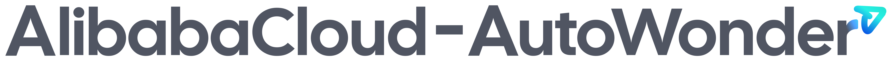
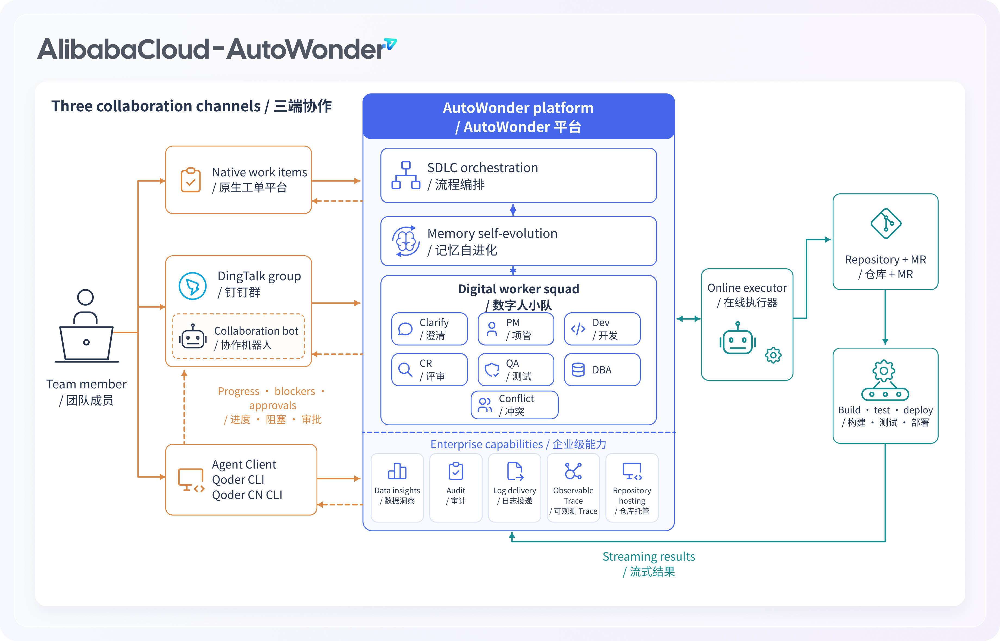
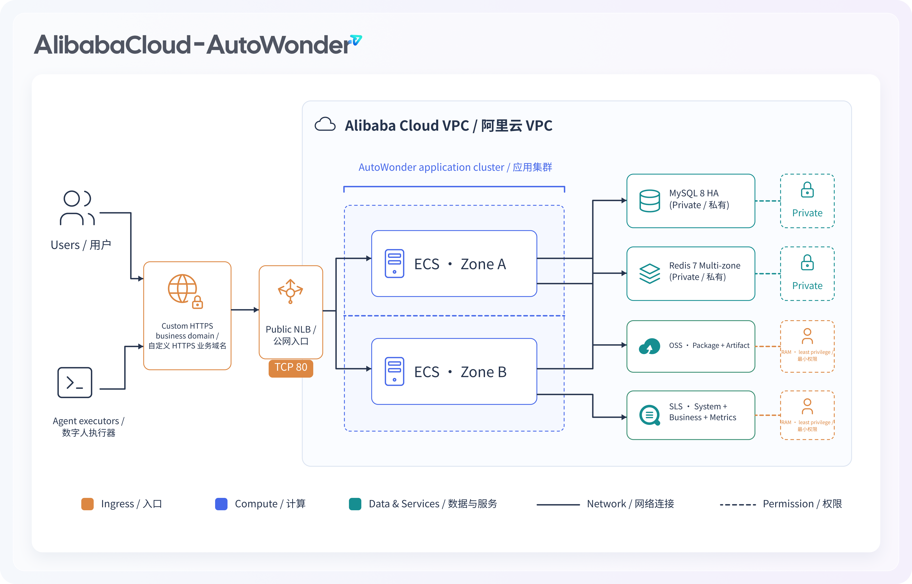
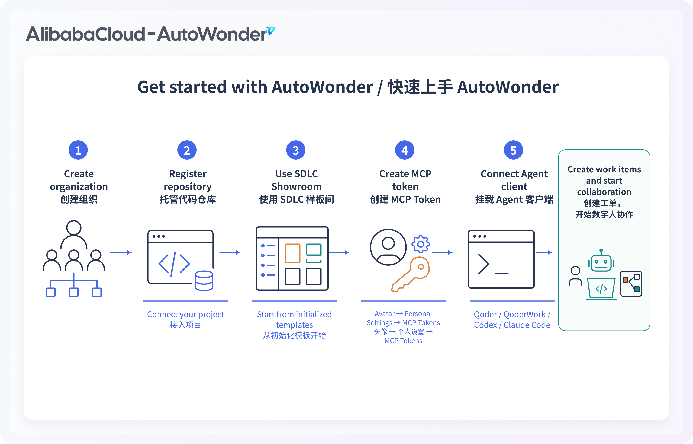

  <strong>English</strong> · <a href="README.zh-CN.md">简体中文</a>

   
  

AutoWonder is an end-to-end software delivery platform for organizations, where
people and teams of AI agents collaborate through deterministic workflows.

Built on Alibaba Cloud's internal AI-native engineering practices, **AutoWonder
shifts software delivery from a human-driven process to one driven by tasks and
coordinated AI agents.**

The project was first open-sourced on August 4, 2026
([Alibaba Cloud Landing Zone](https://github.com/aliyun/alibabacloud-landing-zone/tree/master/ai-sdlc/auto-wonder))
and has since been deployed by more than 100 customers across industries.

Enterprises and organizations can fully self-host AutoWonder on their own
infrastructure and connect it to their internal office and production networks.
They can also deploy it in a cloud VPC.

For a quick proof of concept (POC), use the
[Alibaba Cloud deployment Skill](skills/deploying-autowonder-on-alibaba-cloud/SKILL.md).

## Collaboration Model

Users can collaborate through the native work item platform, supported IM
channels such as DingTalk and Feishu group chats, or a personal Agent client
connected through AutoWonder MCP.

  

## Recommended Deployment

The recommended topology is a multi-zone HA deployment with two application
nodes and private data services.

  

## Model Guidance

| Digital workers | Recommended model | Context |
| --- | --- | --- |
| Development, Testing, Code Review | `DeepSeek-V4.1-Flash` | 1M |
| DBA, Conflict Resolution, Requirements Clarification | `DeepSeek-V4.1-Flash` | 1M |

Use the equivalent model name provided by the selected executor.

## Getting Started

  

Deployment details are in the
[community runtime guide](docs/community/README.md) and the
[Alibaba Cloud deployment Skill](skills/deploying-autowonder-on-alibaba-cloud/SKILL.md).

To connect an executor, follow the [client Runtime guide (Chinese)](docs/runtime-usage.md).

See the [changelog](CHANGELOG.md) for release highlights and upgrade notes.

## License

AutoWonder Community's original code and documentation are distributed under the
[MIT License](LICENSE). Third-party components are subject to their respective
licenses. See [Third-Party Notices](docs/THIRD-PARTY-NOTICES.md) and the notices
included with individual components.
