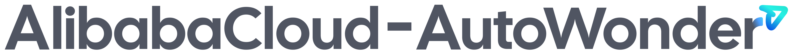
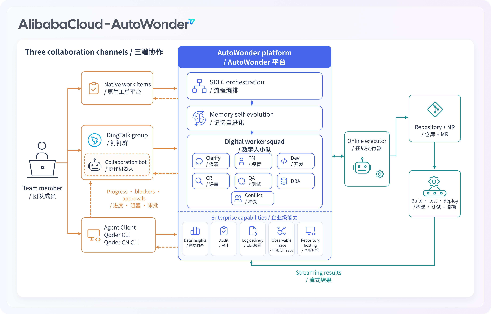
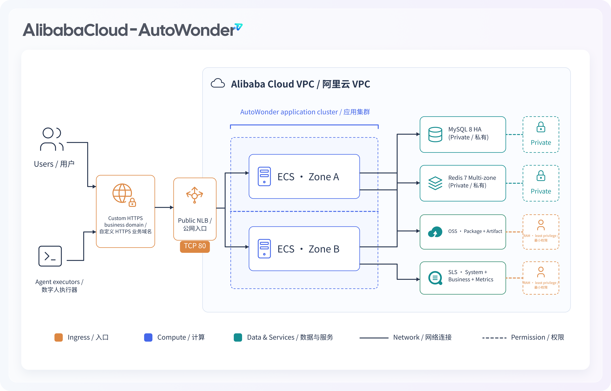
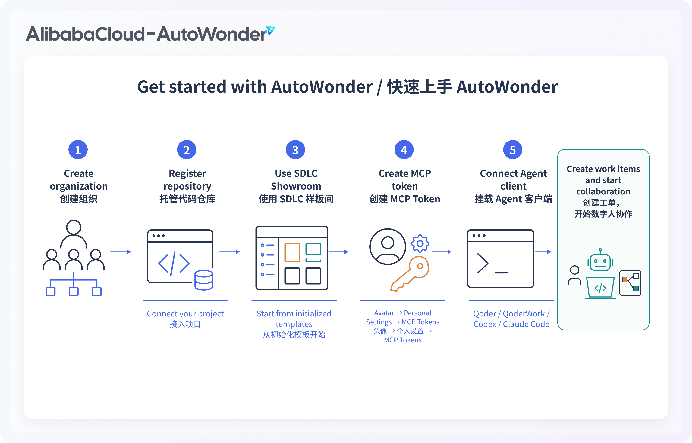

  <a href="README.md">English</a> · <strong>简体中文</strong>

   
  

AutoWonder 是面向组织级软件交付的端到端平台。团队成员与多个 AI 数字人通过确定性的工作流协同交付。

AutoWonder 源于阿里云内部的 AI 原生工程实践，**推动软件交付从人工主导转向任务驱动、多数字人协同的模式。**

项目于 2026 年 8 月 4 日首次开源
（[Alibaba Cloud Landing Zone](https://github.com/aliyun/alibabacloud-landing-zone/tree/master/ai-sdlc/auto-wonder)），现已在多个行业的上百家客户中落地。

企业和组织可在自有基础设施上自主完成全私有化部署，接入内部办公网和生产网，也可将 AutoWonder 部署在云上 VPC 中。

如需快速搭建概念验证（POC）环境，可使用[阿里云部署 Skill](skills/deploying-autowonder-on-alibaba-cloud/SKILL.md)。

## 三端协作

用户可通过 AutoWonder 原生工单平台、钉钉和飞书群聊等受支持的即时通讯（IM）渠道，
或通过 AutoWonder MCP 接入的个人 Agent 客户端协作。

  

## 推荐部署架构

推荐采用跨可用区高可用部署，使用两个应用节点和私网数据服务。

  

## 模型建议

| 数字人角色 | 推荐模型 | 上下文长度 |
| --- | --- | --- |
| 开发、测试、代码评审 | `DeepSeek-V4.1-Flash` | 1M |
| DBA、冲突解决、需求澄清 | `DeepSeek-V4.1-Flash` | 1M |

请使用所选执行器提供的对应模型名称。

## 快速上手

  

部署详情请参阅[社区运行指南](docs/community/README.md)和
[阿里云部署 Skill](skills/deploying-autowonder-on-alibaba-cloud/SKILL.md)。

接入执行器请参阅[客户端 Runtime 使用指南](docs/runtime-usage.md)。

版本亮点和升级注意事项请参阅[变更日志](CHANGELOG.md)。

## 开源许可证

AutoWonder 社区版的原创代码和文档按 [MIT 许可证](LICENSE) 分发。
第三方组件适用各自的许可证，详见[第三方声明](docs/THIRD-PARTY-NOTICES.md)及各组件附带的声明。
